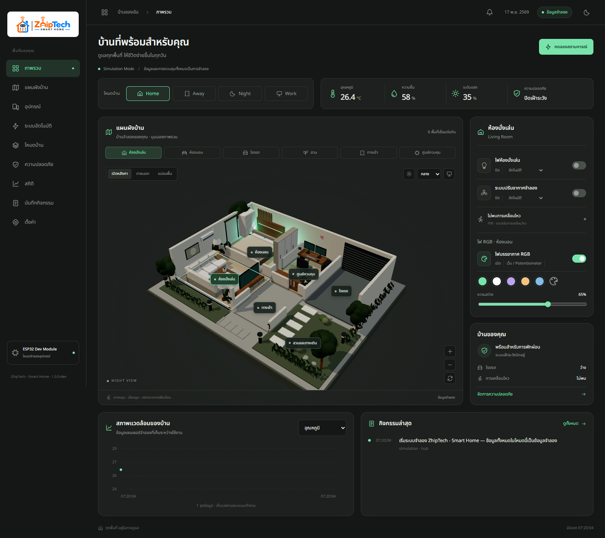
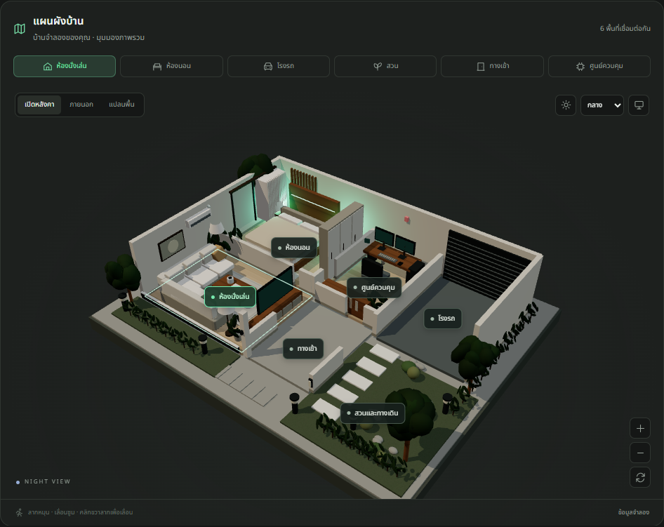
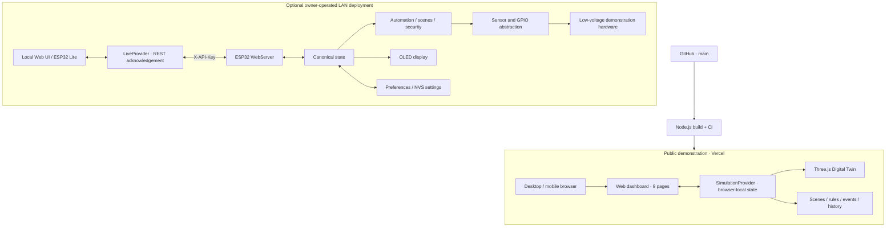

<p align="center">
  
</p>

# ZhipTech - Smart Home

**An interactive 3D smart home demonstration connecting web development, embedded systems and IoT.**

Explore a furnished house in the browser, change its lighting and scenes, simulate sensor events, and inspect the ESP32 firmware that implements the corresponding control logic.

โครงงานสาธิตบ้านอัจฉริยะสำหรับการเรียนรู้ด้านวิศวกรรมคอมพิวเตอร์ ครอบคลุม Software, Hardware, IoT และ 3D Web Development

**[Launch Live Demo](https://zhiptech-smart-home.vercel.app/)** · [Architecture](docs/ARCHITECTURE.md) · [Hardware](hardware/BOM.md) · [Getting started](#getting-started) · [Copyright and usage](#copyright-and-usage)



> **Project status:** the web Simulation is deployed and interactive. Both ESP32 firmware configurations compile. Physical wiring, sensors and live device integration have not yet been verified on a board. Cloud Live is a future milestone.

## Interactive 3D Digital Twin

The house is built from procedural Three.js geometry. Its six zones—living room, bedroom, garage, garden, entrance and control center—share the same device state as the dashboard.

- Rotate, pan and zoom; select a room using a hotspot or the room tabs.
- Switch between cutaway, exterior and floor views, or explore in fullscreen.
- Change day/night rendering and graphics quality independently of device commands.
- See lighting, RGB color/brightness, parking and motion respond to simulation state.
- Keep the camera position while status polling updates the dashboard.
- Use the architectural SVG fallback when WebGL is unavailable, or in the ESP32 Lite build.



Actual screenshots of the [deployed website](https://zhiptech-smart-home.vercel.app/), captured on 17 November 2026. [Mobile screenshot](docs/assets/mobile.png). The original logo is preserved; no replacement brand artwork is used.

## Eight smart home systems

Each system has a browser simulation and a corresponding firmware implementation. The hardware column describes the intended demonstration circuit, not a claim of physical validation.

| System | Behavior and engineering details | Hardware |
| --- | --- | --- |
| **1. Smart Lighting** · ไฟอัจฉริยะ | Motion-triggered living-room light, automatic timeout and persistent manual override | PIR, relay CH1, demonstration LED |
| **2. RGB Ambient Lighting** · ไฟบรรยากาศ | Web color picker and brightness, PWM, scene presets, potentiometer soft takeover/deadband | RGB LED, potentiometer, resistors |
| **3. Smart Climate** · สภาพอากาศ | Temperature/humidity monitoring, configurable threshold, hysteresis and sensor-error safe state | DHT11, relay CH2 and LED representing a fan/AC |
| **4. Smart Parking** · โรงจอดรถ | Occupied/vacant detection, debounce, entry/exit events and audible feedback; no distance measurement | IR module, passive buzzer |
| **5. Smart Outdoor Lighting** · ไฟสวน | Relative-light threshold, hysteresis, manual/auto modes; uncalibrated readings are not labelled lux | Photo sensor, outdoor LED |
| **6. Smart Security** · เฝ้าระวัง | Arm/disarm, motion alert, bounded alarm duration, mute and acknowledgement | Shared PIR, active buzzer |
| **7. Smart Doorbell** · กริ่งหน้าบ้าน | Debounced button, event notification and non-blocking sound scheduling with priority over parking tones | Momentary button, passive buzzer |
| **8. Home Control Center** · ศูนย์ควบคุม | OLED pages for environment, network, scene, security and errors, updated without long delays | ESP32, OLED I2C 128×64 |

The web app includes **nine pages**: Dashboard, Home Map, Devices, Automation, Scenes, Security, Analytics, Activity Logs and Settings. Four default scenes—**Home, Away, Night and Work**—coordinate device modes and security state. Automation supports validated rules, delay and hysteresis; manual overrides take precedence over ordinary rules.

## System architecture



The browser renders the 3D scene on its own GPU. ESP32 processes telemetry and control logic. Simulation and Live use separate providers: Live waits for device acknowledgement, retains stale data when offline, and never silently substitutes simulated readings. See the [architecture](docs/ARCHITECTURE.md) and [API contract](docs/API.md).

## Hardware inventory: 16 component categories

| # | Component | Role |
| ---: | --- | --- |
| 1 | ESP32 Dev Module | Wi-Fi controller, REST server, LittleFS and control loop |
| 2 | 2-channel relay module | Living-room and climate demonstration loads |
| 3 | DHT11 | Temperature and humidity |
| 4 | PIR sensor | Motion input for lighting and security |
| 5 | IR sensor module | Parking presence input |
| 6 | Photo sensor | Relative light level / raw ADC |
| 7 | OLED I2C 128×64 | Local status display |
| 8 | Breadboard | Prototype circuit assembly |
| 9 | 5 mm LEDs | Demonstration loads and garden lighting |
| 10 | Resistors | LED current limiting and required pull-ups/pull-downs |
| 11 | Potentiometer | Local brightness control |
| 12 | Momentary push button | Doorbell input |
| 13 | Active buzzer | Security alarm |
| 14 | Passive buzzer | Doorbell and parking tones |
| 15 | Jumper wires | Prototype signal and power connections |
| 16 | RGB LED | Bedroom ambient light |

The proposed pin map targets an **original ESP32 (`esp32dev`) with a 4 MB flash assumption**. Confirm the actual board, module voltage/polarity, current, pull-ups and driver requirements before wiring. The climate actuator is an LED demonstration; this repository does not provide a mains-voltage installation design.

**Hardware documentation:** [BOM](hardware/BOM.md) · [GPIO map](hardware/GPIO_MAP.md) · [Wiring checklist](hardware/WIRING.md) · [Firmware notes](hardware/FIRMWARE_NOTES.md) · [Build evidence](hardware/BUILD_RESULTS.md)

## Technology stack

| Layer | Technologies |
| --- | --- |
| Frontend | Vanilla JavaScript ES modules, semantic HTML, responsive CSS, bundled Noto Sans Thai |
| 3D | Three.js **0.187.0**, WebGL, OrbitControls, procedural geometry, instanced foliage, bounded shadow quality |
| Firmware | C++ / Arduino ESP32 **2.0.17**, PlatformIO, `espressif32@6.12.0` |
| Device libraries | ArduinoJson, Adafruit DHT / Unified Sensor / SSD1306 / GFX; exact versions in [platformio.ini](platformio.ini) |
| Communication | HTTP REST, JSON schema validation, approximately 2-second status polling in Live |
| Persistence | Browser-local simulation, ESP32 Preferences/NVS settings, bounded event/history buffers |
| Build and checks | Node.js **24.x**, npm lockfile, Node test runner, syntax and release audits |
| Delivery | GitHub Actions, Git integration, Vercel static hosting; production on `main`, previews on other branches |

Three.js, controls, fonts and the logo are served locally with the app. There are no runtime CDN dependencies. No database, MQTT broker or cloud device-control backend is deployed.

## Getting started

Requirements: **Node.js 24.x**, npm and Git. For firmware work, also install Python and PlatformIO or use its VS Code extension.

```powershell
# Choose a workspace on Drive D before cloning.
Set-Location -LiteralPath 'D:\Codex'
git clone https://github.com/SIRAWITBIG/ZhipTech-Smart-Home.git
Set-Location -LiteralPath 'ZhipTech-Smart-Home'
New-Item -ItemType Directory -Force -Path tmp | Out-Null
$env:npm_config_cache = Join-Path $PWD 'tmp\npm-cache'
$env:TEMP = Join-Path $PWD 'tmp'
$env:TMP = $env:TEMP
npm.cmd ci --ignore-scripts
npm.cmd run vendor
npm.cmd run dev
```

Open **http://127.0.0.1:5173**. No credentials are required for Simulation. The optional [.env.example](.env.example) documents the local server port; the scripts do not automatically load `.env` files.

Try a scene, select a room and change its light/RGB controls. Open **ทดลองสถานการณ์** to inject motion, parking, doorbell, temperature, light or sensor/network failures. See the [user guide](docs/USER_GUIDE.md) and [3D controls](docs/3D_DASHBOARD.md).

### Build and verification

```powershell
npm.cmd run check
npm.cmd test
npm.cmd run build
npm.cmd run build:lite
git add .
npm.cmd run audit:release
```

| Command | Result |
| --- | --- |
| `npm run build` | Full interactive 3D website in `dist/` |
| `npm run build:lite` | SVG Lite web UI in `data/` for ESP32 LittleFS; excludes Three.js/model/renderer |
| `npm run preview` | Serve `dist/` locally; stop another server on port 5173 first |
| `npm test` | Provider, UI-contract and public/local origin-policy tests |
| `npm run check` / `lint` | JavaScript syntax checks; not ESLint or TypeScript checking |
| `npm run audit:release` | Check staged source, reachable historical blobs and existing output for credential patterns |

Full and Lite builds enforce separate asset budgets and include gzip variants. Generated assets, portable toolchains, local credentials and audit evidence remain git-ignored. Pattern scans complement review; they cannot prove the absence of every possible secret.

### Compile the firmware

From the repository root, with PlatformIO installed:

```powershell
pio run -e esp32dev
pio run -e esp32dev-hardware-compile
npm.cmd run build:lite
pio run -e esp32dev -t buildfs
```

The default build has `HUB_HARDWARE_ENABLED=0`. The second environment validates enabled-driver compilation; it does not authorize a flash. Copy [config_local.example.h](include/config_local.example.h) to ignored `include/config_local.h` for private settings. Hardware-enabled API access requires a private key of at least 12 characters and a matching `X-API-Key`; a missing/short key fails closed. Follow the hardware review before enabling GPIO or uploading.

## Security and demo boundaries

- **Public demo:** browser-local Simulation only. Visitors can experiment without access to real devices.
- **Local Live:** owner-operated LAN functionality. API key validation happens in firmware; the frontend hostname guard is an additional boundary, not a substitute for authentication.
- **Cloud Live:** disabled until an authenticated backend, device identity and command acknowledgement/expiry are implemented and tested.
- **Secrets:** never commit Wi-Fi passwords, API tokens, `.env.local`, `.vercel` authentication state or private keys. Examples contain empty values.
- **Hardware:** do not expose the ESP32 HTTP server through public port forwarding. Physical runtime/electrical verification remains pending.

For reporting a problem, see [SECURITY.md](SECURITY.md). No real-board integration, physical phone testing or security certification is claimed.

## Repository map

```text
web/src/          Dashboard, providers, 3D engine/model and SVG fallback
web/public/       Approved brand asset and offline font
web/tests/        Automated provider and UI-contract tests
src/              Modular ESP32 firmware
include/          Headers, proposed pins and credential-free configuration
hardware/         BOM, GPIO, wiring and compile evidence
scripts/          Local server, guarded builds, vendor and audit helpers
docs/             Architecture, API, guides, roadmap and real screenshots
Logo/             Original official logo
.github/          CI workflow
```

## Engineering evidence and roadmap

The project demonstrates state-driven visualization, explicit data-provider boundaries, input validation, hysteresis, debounce, manual override, soft takeover, non-blocking sound scheduling, bounded storage and resource-aware Full/Lite builds.

Automated web tests and firmware compilation are verified separately from physical integration. The next milestones are board/wiring validation, live acknowledgement/reconnect tests and an authenticated cloud design. See [test plan](docs/TEST_PLAN.md), [3D QA](docs/QA_3D.md) and [roadmap](docs/ROADMAP.md).

Maintained by **[SIRAWITBIG](https://github.com/SIRAWITBIG)** under the **ZhipTech** project identity.

## Copyright and usage

**Copyright © 2026 Sirawit Sukhrip | ZhipTech. All rights reserved.**

This repository is publicly available as an engineering showcase and portfolio project. No MIT, Apache, GPL or other project-level open-source license is granted. Prior permission from the owner is required to modify, redistribute or commercially use the original source code or ZhipTech branding/logo, except where applicable rights already permit otherwise. Public access does not transfer ownership or grant trademark rights.

เผยแพร่เพื่อแสดงผลงานและประกอบ Portfolio โดยยังสงวนลิขสิทธิ์ Source Code และ Branding การนำโค้ดหรือโลโก้ไปดัดแปลง แจกจ่าย หรือใช้เชิงพาณิชย์ต้องได้รับอนุญาตจากเจ้าของก่อน

This notice does not limit rights provided by GitHub's terms or the licenses of third-party dependencies. Three.js/OrbitControls retain their MIT license, Noto Sans Thai retains its SIL Open Font License, and firmware dependencies retain their respective upstream licenses. Those third-party components are not relicensed by this notice.
