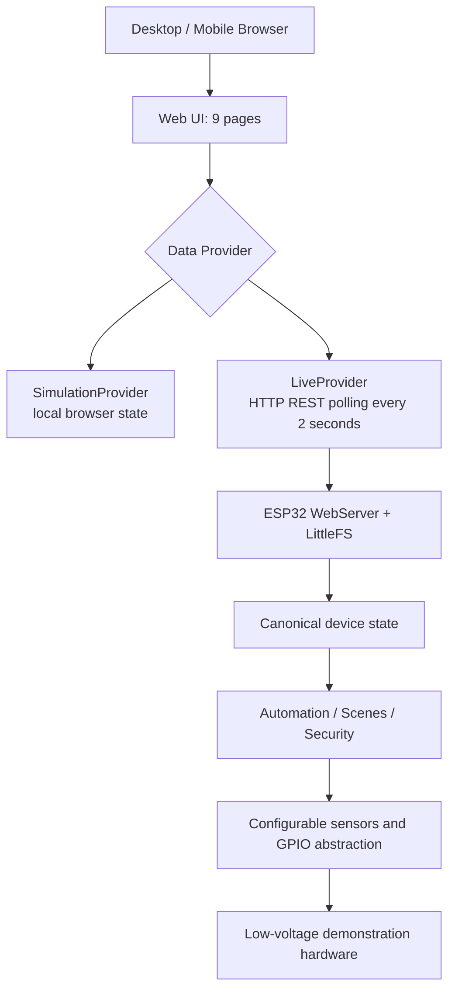

# Architecture

## ขอบเขตและเหตุผลการเลือก

ZhipTech - Smart Home ใช้ **Vanilla JavaScript ES modules + CSS + Three.js 0.187.0** สำหรับบ้านสามมิติจริง และ SVG fallback สำหรับ ESP32 Lite/อุปกรณ์ที่ไม่รองรับ WebGL ตัว browser/GPU ประมวลผลโมเดล ส่วน ESP32 ให้บริการสถานะและควบคุม GPIO ไม่ส่งงานกราฟิกไปประมวลผลบน ESP32

Node.js ใช้เฉพาะพัฒนา/ทดสอบ/build Three.js/OrbitControls vendored ในเว็บพร้อมใบอนุญาต ไม่มี CDN ขณะเปิดใช้งาน รุ่นนี้ใช้ Simulation และ Local Live; Cloud Live ยังไม่ได้พัฒนา backend/database/authentication และไม่แสดงว่าใช้งานได้

## Digital Twin และ build targets

`house-model.js` สร้าง geometry/material/lighting แบบ procedural แยกจาก provider และ GPIO; `house-engine.js` ดูแล WebGL/camera/interactions; `house-view.js` เป็น lazy bootstrap/lifecycle ซึ่งอ่าน canonical state เดียวกับ UI การเลือกห้องไม่สร้าง device state สำเนาใหม่ การเปลี่ยนโลโก้หรือธีมไม่มีผลต่อสัญญาณ GPIO

- Full (`npm run build`): `dist/` รวม Three.js และบ้าน 3D สำหรับ local PC หรือ static hosting เช่น Vercel
- Lite (`npm run build:lite`): `data/` ไม่มี Three.js/house engine/model และตั้ง `window.HUB_LITE=true` ให้ SVG เดิมทำงานพร้อม controls ทั้ง9หน้า
- `vercel.json` ระบุ static build/output; hash routing ไม่ rewrite `/api/*` เป็น HTML ไม่มี API backend บน Vercel ใน milestone นี้
- Renderer ต้องรักษา camera/controls ระหว่าง polling, ลด pixel ratio ตาม quality, pause เมื่อตัวบ้านไม่อยู่ในหน้าที่แสดง, dispose เมื่อออกจาก map/dashboard และใช้ fallback เมื่อ WebGL ไม่พร้อม

## Source of truth

- Simulation: provider ใน browser เป็นแหล่งสถานะ การฉีดค่าเซนเซอร์ใช้สำหรับการทดสอบและติดป้ายจำลองเสมอ
- Live: ESP32 เป็นแหล่งสถานะหลัก UI ส่งคำสั่ง รอ HTTP acknowledgement แล้วอ่านสถานะ canonical ห้าม commit สถานะสำเร็จเองก่อนบอร์ดตอบ
- เมื่ออ่านสถานะไม่ได้ ให้แสดง offline/stale และเก็บข้อมูลครั้งล่าสุดเพื่ออธิบายสิ่งที่เคยอ่านได้ ไม่เปลี่ยนเป็นข้อมูลจำลองอัตโนมัติ
- Switching provider ต้องแยกประวัติและสภาวะผิดพลาดของแต่ละโหมด ไม่ย้ายข้อมูลจำลองเข้า Live

## Firmware responsibilities

| Module | หน้าที่ |
| --- | --- |
| Sensors | DHT11, PIR, IR, photo sensor, potentiometer และ button; rate limit, filtering, debounce, error state |
| Devices | Relay, outdoor LED, RGB PWM และ safe outputs |
| Automation | Threshold, hysteresis, motion timeout และกฎที่จำกัดจำนวน |
| Scenes | Home/Away/Night/Work และ configuration ของแต่ละ scene |
| Security | Arm/disarm, alarm lifecycle, mute/ack และลำดับความสำคัญ |
| Network / Web server | Wi-Fi recovery, protected setup เมื่อกำหนดรหัส, REST validation, static LittleFS |
| Display | OLED แบบสลับหน้า ไม่ขัดขวาง web server |
| Storage | Preferences/NVS สำหรับ configuration; ประวัติแบบ bounded ใน RAM |

Loop ของ firmware ต้องดำเนินต่อได้แม้ไม่มี browser หรือ Wi-Fi การทดสอบบน PC ไม่ทดแทนการทดสอบ timing และวงจรจริง

## ลำดับการควบคุม

1. Sensor failure และ safe hardware configuration จำกัด output ก่อน
2. Security alarm ใช้ active buzzer ตามสถานะ armed, mute และ alarm timeout
3. Scene activation กำหนด mode และ output ที่ระบุไว้; เปลี่ยนสถานะ security ตาม scene ที่เลือกอย่างชัดเจน
4. Manual override ของอุปกรณ์คงอยู่จนเปลี่ยนกลับ Auto หรือเลือก scene ใหม่
5. ระบบ threshold และกฎ automation ทำงานกับอุปกรณ์ใน Auto เท่านั้น

RGB potentiometer ใช้ soft takeover/deadband: การอ่านค่าเดิมทุก loop ต้องไม่เขียนทับสีหรือ brightness ที่ตั้งจากเว็บ ตรวจสอบพฤติกรรมจริงของ provider และ firmware ตาม test plan

## หน่วยความจำและ persistence

Lite frontend build ตรวจขนาด raw + gzip ทั้งหมดไม่เกิน 1,250,000 bytes ก่อนสร้าง `data/`; Full ตรวจงบ12MBแยกที่ `dist/` การจัดเก็บ settings ไม่ควรเขียน flash เมื่อ sensor เปลี่ยนทุกครั้ง เหตุการณ์และ history จำกัดจำนวน; รีบูตบอร์ดอาจล้างข้อมูลใน RAM ส่วนประวัติ simulation เป็น local browser data ไม่ใช่ฐานข้อมูลระยะยาว

PlatformIO ใช้ `default.csv` สำหรับ ESP32 ดั้งเดิม flash 4MB: app partition ละ 1,310,720 bytes และ LittleFS 1,441,792 bytes ขนาด flash/partition นี้เป็นสมมติฐานที่ต้องยืนยันกับบอร์ดจริงก่อน upload; ห้ามใช้ผล compile แทนการยืนยันขนาด flash

## ขอบเขตความปลอดภัย

การสาธิตใช้ LAN ที่เชื่อถือได้ HTTP ไม่มีคุณสมบัติเทียบเท่า HTTPS ห้ามเปิด ESP32 ตรงสู่ Public Internet ใช้ API key ตาม configuration เมื่อเปิดการควบคุมจริง ไม่แสดง credentials ใน response หรือ logs และไม่เก็บไฟล์รหัสผ่านใน repository

Setup AP ต้องมีรหัสผ่านที่กำหนดไว้; หากยังไม่มีการตั้งค่าที่ปลอดภัย ควรคงสถานะ network unavailable แทนเปิดเครือข่ายเปล่า ดู implementation และ configuration จริงก่อนนำบอร์ดไปใช้งาน

Cloud ในอนาคตต้องเป็น outbound verified HTTPS จาก ESP32 ไป API+ฐานข้อมูลถาวร มี owner/device auth, command expiry/idempotency/ack และ local automation ทำงานแม้ cloud ล่ม เว็บไซต์สาธารณะมีเฉพาะ simulation จนกว่าจะพัฒนาขอบเขตดังกล่าวและทดสอบครบ ดู [Deployment](DEPLOYMENT.md)
